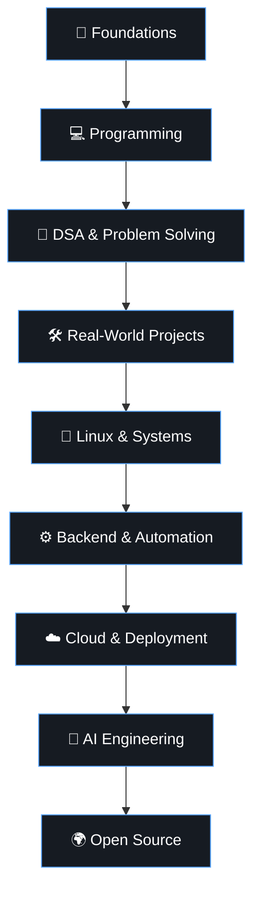

# Hey, I'm Shabi Haider Rizvi 👋

### Computer Science Student · Developer · AI & Automation Enthusiast

I enjoy turning ideas into working software, solving problems, and understanding how systems work under the hood. I'm especially interested in practical AI, full-stack development, developer tooling, and cloud technologies.

- 🤖 Exploring AI, NLP, text embeddings, and Sentence Transformers.
- 🌐 Building applications with React, Tailwind CSS, FastAPI, and PostgreSQL.
- ⚙️ Experimenting with GitHub Actions, CI workflows, and automated testing.
- 🐧 Learning Linux, Bash, Git, cloud infrastructure, and deployment.
- 🧠 Strengthening my data structures, algorithms, and problem-solving skills.

---

## 🚀 Current Focus

| Area | What I'm Learning |
|---|---|
| 🤖 AI & NLP | Sentence Transformers, embeddings, AI-powered applications |
| 🌐 Full Stack | React, Tailwind CSS, FastAPI, PostgreSQL |
| ⚙️ Automation | GitHub Actions, CI pipelines, regression reporting |
| 🐧 Systems | Linux, Bash, Git, deployment, cloud fundamentals |
| 🧠 Problem Solving | DSA, programming fundamentals, software design |

---

## 🛠️ Tech Stack

  

**Currently exploring:** Machine learning, NLP, backend engineering, reliable software delivery, and cloud technologies.

---

## 🧪 Recent Hands-on Work

- **Prompt Wars by GDG** — Participated in a project-focused event and worked through frontend deployment.
- **Developer Workflow Automation** — Experimented with automated checks, CI workflows, and regression-test reporting.
- **AI Application Development** — Exploring an AI-focused application stack using React, FastAPI, PostgreSQL, and Sentence Transformers.
- **YouTube Automation** — Working on a workflow for video metadata generation, email-based approval, and automated uploads.

---

## 📊 GitHub Stats

  
  

## 📈 GitHub Contribution Activity

  

  <i>Weekly contribution activity and cumulative growth over the past year.</i>

  <i>Note: Stats cards are generated through GitHub Actions and may reflect the most recent successful update.</i>

---

## 🧭 My Learning Journey

---

## 🎯 What I'm Working Toward

- Build useful projects that solve real-world problems.
- Improve my understanding of data structures, algorithms, and software design.
- Ship reliable full-stack and AI-powered applications.
- Learn cloud infrastructure, automation, and open-source development.
- Turn experiments into practical, maintainable software.

---

## 🔗 Connect With Me

  
  
  
  

---

  <i>Build → Learn → Improve → Repeat. 🚀</i>

